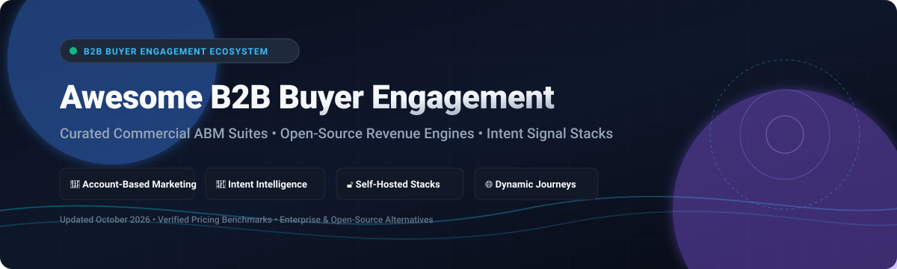

# Awesome-B2b-Buyer-Engagement

# Awesome-B2b-Buyer-Engagement 🤝 📊



  





  
  
  
  
  
  



---

## 🌟 Top B2B Buyer Engagement Ecosystem

**Curated List of Commercial ABM Platforms & Open-Source Buyer Engagement Frameworks**  
*Focused on Intent Data, Account-Based Marketing, Content Personalization, Buyer Intent Signals & Self-Hosted Engagement Platforms*

**Last updated: October 2026** 📅

---

### 📌 Overview & SEO Summary
Welcome to the ultimate curated directory of **B2B buyer engagement platforms**, **open-source ABM frameworks**, and **intent data intelligence tools**. Whether you are looking for enterprise-grade commercial solutions (such as *6sense*, *Demandbase*, and *Terminus*), or self-hostable open-source alternatives (like *Mautic*, *Helio*, and *Tailor*), this list covers category leaders, account intelligence, and privacy-respecting buyer engagement.

**Key Market Context:**
- **6sense and Demandbase carry median annual contract values of $62,440 and $68,591** respectively, with enterprise implementations running **8–12 weeks** and requiring **9–12 months to demonstrate measurable ROI** .
- **Terminus merged into DemandScience on November 12, 2024** with terminus.com redirecting to demandscience.com and **Ionic as the surviving orchestration product** .
- **PathFactory was acquired by Kaltura on April 1, 2026** — ask about roadmap before committing .
- **Folloze does not publish list pricing** — any figure found is a third-party estimate rather than a rate card .
- **ZoomInfo released the GTM.AI CLI as open source under the MIT license** in July 2026 — search and lookup commands are free, with enrichment and agentic research consuming bulk data credits from an active subscription .
- **Mautic powers marketing automation for 40,000+ companies** and provides **comprehensive customer insights, segmentation, personalization, and omnichannel automation** with **open source flexibility and data ownership** .
- **Helio is an open-source, self-hostable, data-sovereign growth platform** with **AI-native marketing automation (CDP, segmentation, cross-channel journeys, email, analytics)** — load-tested at **20,000 events/s at p95 81ms** .
- **Laudspeaker is the open-source Braze/Iterable alternative** with **omnichannel messaging (email, SMS, push)**, **no-code journey builder**, **time delays and time windows**, **user segments**, and **Postgres/CSV imports** .

---

## 📑 Table of Contents
- [🏢 SaaS & Commercial Platforms](#-saas--commercial-platforms)
- [🔓 Open-Source GitHub Projects](#-open-source-github-projects)
- [🛠️ How to Contribute](#%EF%B8%8F-how-to-contribute)
- [📊 Star History](#-star-history)
- [🤝 Support & Sponsorship](#-support--sponsorship)
- [⚠️ Disclaimer](#%EF%B8%8F-disclaimer)

---

## 🏢 SaaS / Commercial Platforms

The B2B buyer engagement market spans **intent data platforms** (6sense, Demandbase, Leadpoet) that identify **which accounts are actively in market**, **account-based marketing platforms** (Terminus, Folloze, PathFactory) that orchestrate **targeted engagement across channels**, and **direct mail and gifting platforms** (Sendoso, Alyce) that create **tangible touchpoints for key buyers**. **6sense and Demandbase median contracts are $62,440 and $68,591** respectively, with **hidden costs including ad spend, data enrichment, and implementation that can double first-year investment** . **Terminus is now DemandScience** with **Ionic as the surviving orchestration product** . **PathFactory is now part of Kaltura** — ask about roadmap .

| SaaS / Commercial Platform | Company / Owner | Valuation / Market Cap | Standard Edition Starting Price | Free Tier / Free Trial Limits | Description |
| :--- | :--- | :--- | :--- | :--- | :--- |
| **[6sense](https://6sense.com/)** 🎯 | 6sense | Private | **No published pricing**; median contract **$62,440**  | **No free plan**  | **Intent data and ABM platform** — **Identifies accounts actively in market** using AI-powered intent signals. **Enterprise-focused, built for running ABM across thousands of accounts with complex buying committees** . **Implementation: 8–12 weeks; ROI: 9–12 months** . |
| **[Demandbase](https://www.demandbase.com/)** 🔷 | Demandbase | Private | **No published pricing**; median contract **$68,591**  | **Free tools but no free platform version**  | **Account intelligence and ABM platform** — **Enterprise intent and account intelligence** . **Premium end of the market, best suited for enterprise teams with dedicated RevOps resources and significant ad budgets** . |
| **[Terminus (now DemandScience)](https://www.demandscience.com/)** 🟢 | DemandScience | Private | **Mid-market tools closer to $23,000/year**  | **No free tier**; demo required | **ABM orchestration platform** — **Terminus merged into DemandScience on November 12, 2024** with **Ionic as the surviving orchestration product** . **DemandScience for verified buyer data** . |
| **[Folloze](https://www.folloze.com/)** 🟣 | Folloze | Private | **No published list price**; third-party estimates available  | **Demo available** | **Buyer engagement platform** — **Builds a curated destination for a named account, best in 1:1 and 1:few programs** . **Does not publish list pricing** — any figure found is a third-party estimate . |
| **[PathFactory (now Kaltura)](https://www.pathfactory.com/)** 🔵 | Kaltura | ~$2 Billion | **Comparable contracts typically start in $50k–$80k range with services packages**  | **Demo available** | **Content intelligence platform** — **Sequences and recommends content for self-serve buyers at volume** . **Adds ChatFactory buying agents plus AI Search Optimization** . **Acquired by Kaltura on April 1, 2026** — ask about roadmap . |
| **[Sendoso](https://www.sendoso.com/)** 🎁 | Sendoso | Private | **Custom enterprise pricing** | **Demo available** | **Corporate gifting and direct mail platform** — **Enables sales, marketing, and customer success teams to send physical and digital gifts at scale** . **Integrates with Salesforce, HubSpot, Outreach, Marketo, and other CRM and sales engagement tools** . |
| **[Alyce](https://www.alyce.com/)** 🧠 | Alyce | Private | **Custom enterprise pricing** | **Demo available** | **Personal gifting platform** — **AI-powered gift recommendations for B2B buyer engagement** . |
| **[Mutiny](https://www.mutinyhq.com/)** 🌐 | Mutiny | Private | **Custom enterprise pricing** | **Demo available** | **Website personalization platform** — **Personalizes web experiences for target accounts** . |
| **[Leadpoet](https://leadpoet.com/)** 📊 | Leadpoet | ~$750K pre-seed | **Custom pricing** | **No free tier**; demo available | **AI-driven intent data** — **Analyzes open source web signals including social media posts, funding announcements, hiring activity, and other public indicators** to surface companies showing active buying intent . **Each recommended lead includes contextual evidence explaining why that company may be in market** . **Built on Bittensor decentralized AI network** . |
| **[ZoomInfo GTM.AI CLI](https://github.com/Zoominfo/gtm-ai-cli)** ☁️ | ZoomInfo | ~$4 Billion | **Open source under MIT license**  | **Free: search and lookup commands**  | **Command-line client for verified GTM data** — **Search and enrich companies and contacts, pull intent signals, Scoops, and news, and run agentic research directly from the shell** . **Connects to GTM Context Graph with 100M+ companies, 500M+ contacts, and billions of buying signals** . **Enrichment and agentic research consume bulk data credits** . |

---

## 🔓 Open-Source GitHub Projects

*Sorted by GitHub_Stars_Count (Descending)* 🌟

- **[Mautic](https://github.com/mautic/mautic)**   
  **World's first open-source marketing automation product**, GPL-3.0 licensed. **40,000+ companies use Mautic**  — **comprehensive customer insights, segmentation, personalization, and omnichannel automation** . **Develop a single source of truth across your organization for the customer** — centralize all data points and activity across website, app, and in-store POS devices . **Open source flexibility with data ownership** — customize, integrate, and extend while retaining ownership of customer data . **Email, SMS, browser app, and web notifications out of the box** . **The most widely deployed open-source B2B buyer engagement platform** . 🏛️

- **[Helio](https://github.com/achref-soua/helio)**   
  **Open-source growth platform — AI-native marketing automation: CDP, segmentation, cross-channel journeys, email, analytics. Self-hostable, data-sovereign** . **Load-tested at 20,000 events/s at p95 81ms** — **4× the ≥5,000 events/s budget** . **Multi-tenant isolation enforced at the database via PostgreSQL row-level security** . **Journey sends run on Temporal with explicit retry policies** . **Docker Compose profiles for local/self-host, Helm chart for Kubernetes, cloud-init for fastest hosted start** . **The most technically rigorous open-source buyer engagement platform** . 🚀

- **[Laudspeaker](https://github.com/laudspeaker/laudspeaker)**   
  **Open-source customer journey automation — a Braze/Iterable alternative**, open-source. **Powers event-triggered cross-channel messages** — **have emails, SMS, and push automatically reach your users when, where and how you want** . **No-code journey builder**, **time delays and time windows** for drip campaigns, **user segments**, **database imports (Postgres) and CSV imports**, and **PostHog plugin** . **The most complete open-source omnichannel engagement platform** . 🎨

- **[Tailor](https://github.com/mlndshh/tailor)**   
  **Websites that adapt to every visitor, powered by Jev**, open-source. **React SDK plus a stateless decision API** — **your team writes a version of each section per audience** . **Tailor watches on-site behaviour (clicks, reading time, code copies), Jev decides who the visitor is, and the page re-renders headlines and buttons, reorders sections, and highlights the right pricing plan** . **Never hides anything, never changes what you're reading, only acts when Jev is confident, handles more than one audience** . **About 0.5s server-side per decision, ~1.2k input tokens, roughly $0.00005 per decision** . **The most innovative open-source web personalization platform** . 🎯

- **[Tracardi](https://github.com/Tracardi/tracardi)**   
  **Open-source customer data platform**, open-source. **Helps users engage with customers through automated digital experiences to improve sales performance** . **Create customer databases, track and manage interactions, collect data from different channels (mobile, web, IoT), automate personalized messages and targeted campaigns, and trigger actions based on events** . **Integrates with external systems including social media, SaaS, and AI** . **The most accessible open-source CDP for buyer engagement** . 📊

- **[ZoomInfo GTM.AI CLI](https://github.com/Zoominfo/gtm-ai-cli)**   
  **Command-line client for verified go-to-market data**, MIT licensed . **Open source under MIT license** — **search and lookup commands are free** . **Installation via Homebrew or npm with prebuilt binaries for macOS, Linux, and Windows** . **OAuth sign-in in browser, no client ID or secret to paste** . **Results return as JSON, JSONL, CSV, YAML, or table — pipes cleanly into warehouse jobs, CRM updates, and agent workflows** . **The most developer-friendly open-source GTM data CLI** . 🛠️

- **[abmbuddy](https://github.com/membranedev/abmbuddy)**   
  **Agentic account research CLI with HubSpot write-back**, open-source. **Research any company from the command line — needs nothing but an AI key** . **`npx abmbuddy research stripe.com` for single companies, `--hubspot --all` for entire CRM portals** . **Collectors are deterministic (never agents)** — company-web, news, jobs, SEC filings, leadership content . **Agents (Vercel AI SDK, Zod schemas, Markdown prompts) handle extraction, signal, hypothesis, and outreach** . **One collector failing never fails an account, and one account failing never stops the run** . **The most accessible open-source agentic account research tool** . 🔍

- **[reddit-intel-agent-mcp](https://github.com/...)**   
  **Reddit intelligence for B2B buyer intent**, open-source. **14 tools, all free, no signup required, no API key needed** . **`find_buyer_intent`** finds people looking to buy products — **returns lead list with usernames, post URLs, intent scores, urgency (low/medium/high), budget hints, and signal tags** . **The most accessible open-source buyer intent signal tool** . 📡

- **[Tenger Plugin](https://wordpress.org/plugins/tenger/)**   
  **WordPress plugin for ABM marketing**, open-source. **Designed for non-technical marketing users intending to do ABM marketing** . **The most accessible ABM tool for WordPress sites** . 🔌

---

## 🛠️ How to Contribute

Contributions are welcome! Follow these steps to submit new B2B buyer engagement platforms or open-source ABM software:

1. 🍴 **Fork** the repository.
2. 📝 **Add/edit** entries in `README.md` maintaining table/list structure and formatting.
3. 🔗 Include project title, official website/GitHub link, exact Stars_Count, license, and brief description.
4. 🚀 Submit a **Pull Request** with a descriptive summary of your changes.

---

## 📊 Star History



---

## 🤝 Support & Sponsorship

If you find this B2B buyer engagement repository useful, please consider supporting the project:

- ⭐ **Star** this repository to increase visibility!
- 🔀 **Fork** and share with fellow demand generation leaders, ABM strategists, and open-source advocates.
- ☕ **Sponsor & Buy Me a Coffee**: Support ongoing open-source curation via the [GitHub Sponsor Dashboard](https://github.com/sponsors/ishandutta2007).

---

## ⚠️ Disclaimer

- This is a **community-curated** list — not exhaustive and not an endorsement. ℹ️
- **6sense and Demandbase sit at the premium end** — **publish no pricing, carry Vendr median contracts of $62,440 and $68,591** respectively, and **require 8–12 week implementations with 9–12 months to demonstrate measurable ROI** . **Hidden costs — particularly ad spend, data enrichment, and implementation — can double first-year investment** .
- **Terminus merged into DemandScience on November 12, 2024** — **Ionic is the surviving orchestration product** . **PathFactory was acquired by Kaltura on April 1, 2026** — **ask about roadmap before committing** . **Folloze does not publish list pricing** — any figure found is a third-party estimate .
- **Open-source buyer engagement platforms are not turnkey** — **Mautic requires PHP and MySQL** . **Helio requires Docker, PostgreSQL, Redis, and ClickHouse** . **Laudspeaker requires Node.js and PostgreSQL** . **Always validate intent data accuracy, personalization quality, and CRM data hygiene with a proof-of-concept** before production deployment. 📊

---



  <b>Made with ❤️ for demand generation leaders, ABM strategists, and open-source buyer engagement advocates.</b>

